# Craft Wiki

Browse setup guides, workflows, and troubleshooting by app. In TileDocs, use this page as the home page and turn each app entry into an Image Card linking to that app’s Overview page.

## Apps

- [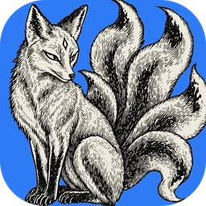 PhotoCraft](./apps/photocraft/overview.md)
- [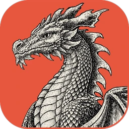 VectorCraft](./apps/vectorcraft/overview.md)
- [ FilmCraft](./apps/filmcraft/overview.md)
- [ LightCraft](./apps/lightcraft/overview.md)
- [ PdfCraft](./apps/pdfcraft/overview.md)
- [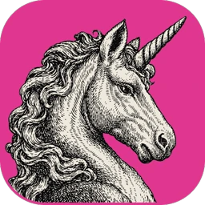 EffectCraft](./apps/effectcraft/overview.md)
- [ DesignCraft](./apps/designcraft/overview.md)
- [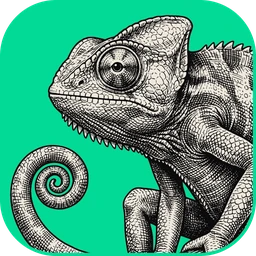 FigCraft](./apps/figcraft/overview.md)
- [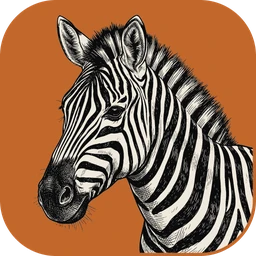 TextureCraft](./apps/texturecraft/overview.md)
- [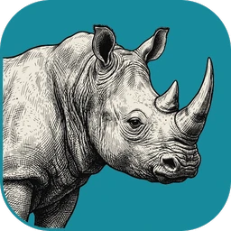 MaterialCraft](./apps/materialcraft/overview.md)
- [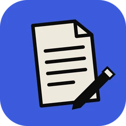 WordCraft](./apps/wordcraft/overview.md)
- [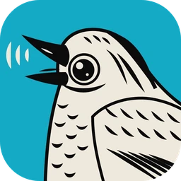 SoundCraft](./apps/soundcraft/overview.md)
- [ DeckCraft](./apps/deckcraft/overview.md)
- [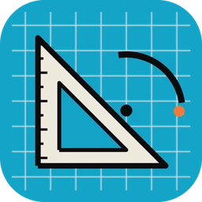 CADCraft](./apps/cadcraft/overview.md)
- [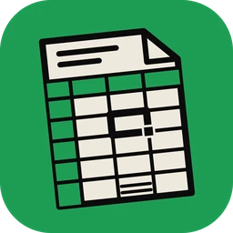 GridCraft](./apps/gridcraft/overview.md)
- [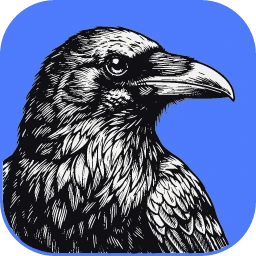 Craft Anything](./apps/craft-anything/overview.md)
- [ ArtCraft Studio](./apps/artcraft-studio/overview.md)

Each app folder in the TileDocs navigation should expand to show its Overview, Getting started, Install and update, Workflows, and Troubleshooting pages.
